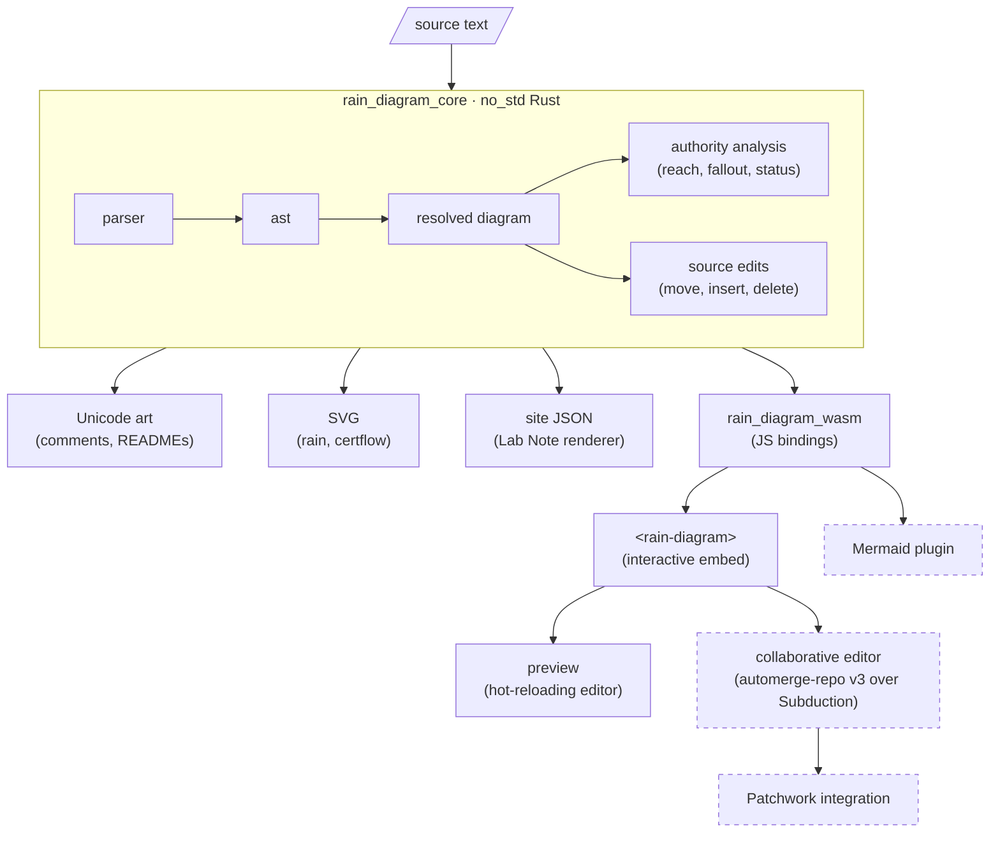
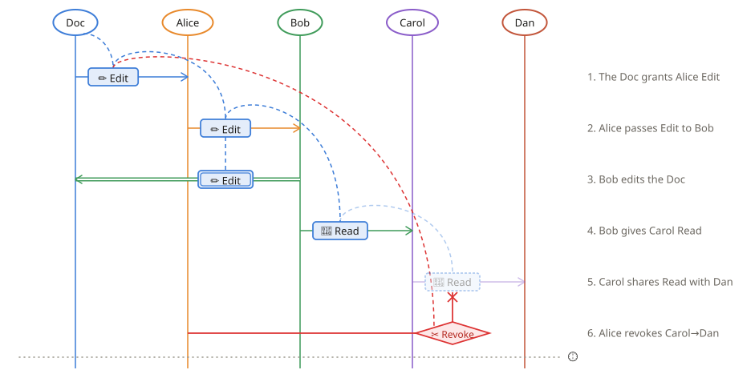

# Rain Diagrams

> [!WARNING]
> This project is pretty vibey. It started as a sketch to see if the plain-text notation from the Keyhive Lab Notes ([#7][certflow], [#8][rain]) could be parsed and rendered, and much of it was written with an AI pair. Expect sharp edges, churn, and opinions that haven't been tested on anyone yet.

A plain-text notation, authority analysis, and renderers for _certflow_ and _rain_ diagrams: pictures of how authority flows through certificate capability systems like [Keyhive].

- [Keyhive Lab Note #7: Certflow Diagrams][certflow] explains the snapshot view
- [Keyhive Lab Note #8: Rain Diagrams][rain] adds time, and the plain-text form this project parses

## The Notation

```
rain                                    %% or `certflow`
title Revoking two hops downstream

(Doc)-[edit]->(Alice)                   : The Doc grants Alice Edit
(Alice)-[edit(Doc)]->(Bob)              : Alice passes Edit to Bob
(Bob)=[[edit]]=>(Doc)                   : Bob edits the Doc
(Bob)-[read]->(Carol)                   : Bob gives Carol Read
cd: (Carol)-[read]->(Dan)               : Carol shares Read with Dan
(Alice)-<revoke>-x[cd]                  : Alice revokes Carol→Dan
```

Principals get round brackets, certificates get square ones (like the shapes in the diagrams), and invocations get double lines.

| Form                              | Meaning                                                     |
|-----------------------------------|-------------------------------------------------------------|
| `(A)-[edit(S)]->(B)`              | A delegates Edit over S to B                                |
| `(A)-[edit]->(B)`                 | Same, with S inferred from what A holds                     |
| `(A)-[edit(S) via ta]->(B)`       | Force the route through `ta` (routes are otherwise derived) |
| `label: (A)-[…]->(B)`             | Label a certificate (otherwise it's implicitly `a-b`)       |
| `(B)=[[edit]]=>(S)`               | B uses its Edit authority on S                              |
| `(A)-<revoke>-x[label]`           | A revokes the certificate `label`                           |
| `(A)---[edit]->(B)`               | More dashes before the label slide it towards B (here ¾)    |
| `>>> A (P): note` … `<<< A`       | A captioned region; `(P)` takes principal P's colour        |
| `principals: A, B`                | Fix column order (`participant A, B` works too)             |
| `title …`, `: note`, `// comment` | Annotations (`%%` comments work too)                       |

Levels are `admin`, `edit`, `read`, and `relay` (or 👑 ✏️ 👀 📡).

With no subject, `admin` is over the issuer itself (ownership, group membership: `(Team)-[admin]->(Alice)` adds Alice to Team), and anything else passes on the one subject the issuer holds. If it holds several, name the one you mean.

Regions are closed by name, so they can nest or overlap. In the SVG they're tinted boxes with the note in a tab; in the text art, an outline in the notes column: the caption, then a `║` bar beside the rows it covers, with their notes indented. Powerlines in the SVG animate (dashes march in the direction authority flows) unless the viewer prefers reduced motion.

Powerlines, attenuation, transitive handles, and revocation fallout are _derived_ from the certificates, not drawn by hand, so they can't be drawn wrong. Things that resolve but don't do what they look like (delegating without authority, claiming more than you hold, revoking from outside the chain) are reported as warnings rather than errors, since diagrams sometimes show them on purpose.

## Architecture



Dashed boxes are planned.

| Crate / package      | Status    | Purpose                                                      |
|----------------------|-----------|--------------------------------------------------------------|
| `rain_diagram_core`  | Working   | Parser, resolver, authority analysis, renderers              |
| `rain_diagram_wasm`  | Working   | JS bindings (`renderSvg`, `renderText`, `toSiteJson`, …)     |
| Text renderer        | Working   | Unicode art matching [Keyhive Lab Note #8][rain] exactly     |
| SVG renderer         | Working   | Static export, with `data-*` hooks for the interactive embed |
| certflow renderer    | Working   | Snapshot view with automatic (stress majorization) layout    |
| Web component        | Prototype | `<rain-diagram>`: hover for reach, click for fallout         |
| Mermaid plugin       | Planned   | `registerExternalDiagrams` adapter                           |
| Collaborative editor | Planned   | Shared source via automerge-repo v3, synced over Subduction  |

## Exports

| Format     | Rust                    | Wasm / JS     | Use                                                         |
|------------|-------------------------|---------------|-------------------------------------------------------------|
| Plain text | `Diagram::to_text`      | `renderText`  | Code comments, READMEs, terminals                           |
| SVG        | `Diagram::to_svg`       | `renderSvg`   | Rain or certflow, as the header says (or choose: see below) |
| Site JSON  | `Diagram::to_site_json` | `toSiteJson`  | The renderer in the [Keyhive Lab Notes][rain]               |

`to_rain_svg` and `to_certflow_svg` pick a notation regardless of the header. The preview has Copy and Download for each, and `cargo run --example render [-- --svg | --json] < diagram.rain` does the same from a shell.

Here's the example from [Keyhive Lab Note #8][rain], drawn by `to_svg`:

<!-- Regenerate with: BLESS=1 cargo test --test golden -->


And by `to_text`, matching the Lab Note's plain-text version character for character:

```
 (Doc)       (Alice)       (Bob)       (Carol)       (Dan)
   │╰┄┄┄╮ ╭┄┄┄┄┄┼┄┄┄┄╮       │            │            │
   ├──[edit]───▶│    ┆       │            │            │   1. The Doc grants Alice Edit
   │     ┆      │    ┆       │            │            │
   │     ┆      │    ┆ ╭┄┄┄┄┄┼┄┄┄┄╮       │            │
   │     ┆      ├──[edit]───▶│    ┆       │            │   2. Alice passes Edit to Bob
   │     ┆      │    ┆       │    ┆       │            │
   │     ┆      │    ┆       │    ┆       │            │
   │◀════╪══════╪═[[edit]]═══╡    ┆       │            │   3. Bob edits the Doc
   │     ┆      │            │    ┆       │            │
   │     ┆      │            │    ┆ ╭┄┄┄┄┄┼┄┄┄┄╮       │
   │     ┆      │            ├──[read]───▶│    ┆       │   4. Bob gives Carol Read
   │     ┆      │            │            │    ┆       │
   │     ┆      │            │            │    ┆       │
   │     ┆      │            │            ├──[read]───▶│   5. Carol shares Read with Dan
   │     ┆      │            │            │    ✗       │
   │     ┆      │            │            │    │       │
   │     ╰┄┄┄┄┄┄o────────────┼────────────┼─<revoke>   │   6. Alice revokes Carol→Dan
   │            │            │            │            │
```

## Embedding

`<rain-diagram>` renders the SVG and makes it interactive: hover a principal to trace everything it can reach, click a certificate to preview what revoking it would void. It's a prototype that lives in `preview/` until it gets packaged. See `preview/embed.html`, served at `/embed.html` by the preview.

```html
<script type="module" src="./rain-diagram.js"></script>

<rain-diagram><script type="text/rain">
  rain
  (Doc)-[edit]->(Alice)
  (Alice)-[edit]->(Bob)
  (Doc)-<revoke>-x[doc-alice]
</script></rain-diagram>

<rain-diagram src="./revocation.rain"></rain-diagram>
```

Inline source goes in a `text/rain` script so that HTML doesn't swallow `<revoke>` as a tag (plain text content works for diagrams without revocations).

Add `notation="rain"` or `notation="certflow"` to draw a source in the other notation, and the same hover and click behaviour works in both.

It fires `rain-reach` and `rain-fallout` events, and the SVG's `data-*` hooks are documented in `rain_diagram_core::svg` for anyone wiring their own.

## Development

```console
$ nix develop        # toolchain, wasm-pack, and a command menu
$ preview            # (in the shell) hot-reloading preview at http://127.0.0.1:8080
$ nix run .#preview  # same, without entering the shell (PORT=… to change)
$ cargo test --workspace --exclude rain_diagram_wasm
$ nix run .#ci-clippy   # also: ci-fmt, ci-test, ci-doc, ci-no-std, ci-bolero, ci-deny, ci-msrv, ci-typos
```

## License

Licensed under either of [Apache License, Version 2.0](./LICENSE-APACHE) or [MIT license](./LICENSE-MIT) at your option.

[certflow]: https://www.inkandswitch.com/keyhive/notebook/07/
[Keyhive]: https://github.com/inkandswitch/keyhive
[rain]: https://www.inkandswitch.com/keyhive/notebook/08/
