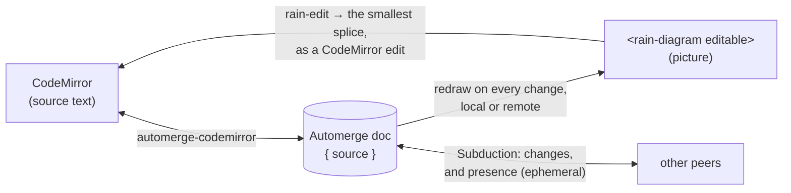

# `@inkandswitch/downpour-editor`

> [!NOTE]
> Early, on alpha dependencies. Text and picture edits sync between browsers through Subduction, with presence, per-person undo, and offline use.

A collaborative editor for rain and certflow diagrams. The source text lives in an Automerge document, synced with automerge-repo v3 over [Subduction](https://github.com/inkandswitch/subduction). The text is edited in CodeMirror and the picture in an editable [`<rain-diagram>`](../rain-diagram/), side by side. It shares its page with the single-user [preview](../preview/) (`../preview/shell.js`, `highlight.js`, `examples.js` and `style.css`), which stays build-free and dependency-free.

Deployed with the preview at [inkandswitch.github.io/downpour/collab/](https://inkandswitch.github.io/downpour/collab/). To run it locally:

```console
$ nix run .#editor        # from the repo root: http://localhost:5173 (PORT=… to change)
```

It installs the JS dependencies if needed, builds the component's Wasm, and starts Vite.

Open the page, then open its URL (with the `#automerge:…` it adds) in another browser. `?sync=wss://…` picks a different Subduction server. `#source=…` (URL-encoded text) starts a new shared document with that text, which is how the preview's _Collaborate_ button hands its diagram over; the URL then becomes the document's link. Locally, the preview's dev server sends `/collab/` to this one (`nix run .#editor`, or `EDITOR_PORT`).

## What it does

- **Two views of one text.** Typing in CodeMirror and dragging in the picture both edit `source`. The picture redraws on every change, local or remote.
- **Text that doesn't parse** (someone mid-edit) keeps the last good diagram up on every replica, with the error in the status line and its line marked.
- **The preview's highlighting.** Principals take their diagram colours.
- **Presence.** Each person has a name like `silly-teal-otter`, and a caret and selection in that colour. Click your own name to change it. Carets are Automerge cursors, so they stay on their character as others type. Leaving drops you at once.
- **Undo is per person.** Undo covers your own typing, picture edits, and examples you load, and never someone else's edits.
- **Examples.** _Basic example_ and _Tour_ replace the text for everyone, as one undoable edit.
- **Sync status.** The header shows _synced_ once the server holds everything this tab has, _syncing…_ on the way, and _not synced_ offline, with where the changes are kept.
- **Offline.** One tab per browser keeps documents in IndexedDB, under the browser's own identity. Other tabs sync live, in memory. A document made offline syncs when the server is back. A document not on the server yet is looked for until it turns up.

## How it fits together



- **The document is text.** The diagram is always derived from `source`. A concurrent edit can't corrupt a structure. At worst, the merged text doesn't parse, and the picture keeps its last good state.
- **Every edit goes through CodeMirror.** The component reports a whole rewritten source. The editor diffs it against the text and applies the smallest splice as a CodeMirror transaction. So picture edits join this person's undo history, CodeMirror maps that history through remote edits, and someone typing elsewhere at the same moment keeps their edit.
- **Undo is CodeMirror's history, kept to this person.** Remote changes arrive without a user event and stay out of it.

## Embedding: `mountEditor`

The page is a thin shell around [`src/mount.js`](src/mount.js), which mounts the editor on any document handle whose doc has a `source` string. The [Patchwork tool](../patchwork/) uses it the same way.

```js
import { mountEditor } from "@inkandswitch/downpour-editor/mount";

const { view, unmount } = await mountEditor(element, handle, {
  shadow: true, // its own shadow root and styles: for someone else's page
  name: "Ada", // this person's name for presence, if known
});
```

| Option | Default | Meaning |
|---|---|---|
| `shadow` | `false` | Mount in a shadow root of its own, with the page's styles inside it. Without it, the host page supplies `style.css` and the ids are global. |
| `styles` | none | More CSS for that shadow root, such as mapping the host's theme variables onto `--bg`, `--fg`, `--panel`, `--border` and `--muted`. |
| `people` | none | An element to list who's here in. |
| `name` | generated | This person's name, for presence. |
| `prefix` | `"rain-editor"` | Key prefix for per-viewer settings in `localStorage`. |

The returned `host` is the shadow root's host. Set its `data-theme` to `light` or `dark`.

## The stack (all pinned: these are alphas)

| Package | Version | Role |
|---|---|---|
| `@automerge/automerge-repo` | 3.0.0-alpha.2 | Documents, handles (`create`/`find` are async in v3), and `Presence` |
| `@automerge/automerge-repo-subduction` | 3.0.0-alpha.2 | The `SubductionBackend` passed to `new Repo({ backend })` |
| `…-subduction-network-websocket` | 3.0.0-alpha.2 | Connection to the sync server (default `wss://subduction.sync.inkandswitch.com`) |
| `…-subduction-storage-indexeddb` | 3.0.0-alpha.2 | Local storage, so documents work offline |
| `@automerge/subduction` | 0.27.0 | `createWebCryptoSigner()`: a stable peer identity per browser |
| `@automerge/automerge` | 3.5.0 | Importing it initializes the Wasm the `slim` imports share; cursors for presence |
| `@automerge/automerge-codemirror` | 0.2.0 | CodeMirror ↔ document (written for repo 2.0; the v3 handle fits) |

## Size

What a first visit downloads, from a release build (gzip at level 9):

| Part | gzip | Brotli | Share |
|---|---|---|---|
| Automerge's Wasm | 1110 KB | 774 KB | 54% |
| Subduction's Wasm | 653 KB | 481 KB | 31% |
| JS (CodeMirror, automerge-repo, the editor) | 180 KB | 153 KB | 9% |
| The diagram's Wasm (`rain_diagram_wasm`) | 130 KB | 103 KB | 6% |

The sync stack is 84% of it, and it isn't ours to shrink. Inside [Patchwork](../patchwork/), which ships Automerge and Subduction itself, the editor is about 30 KB of JS (gzipped) plus the diagram's Wasm. Here, CodeMirror's setup leaves out autocomplete, lint and folding (nothing to complete or fold in this text), which saves a tenth of the JS. GitHub Pages serves gzip, not Brotli.

## Tests

[`browser-test/`](browser-test/) drives the built editor in headless Chromium over the DevTools protocol, with each browser as one person. It covers the page, the theme, broken text, per-person undo, presence, the examples, the sync status, offline use, two tabs, and the Patchwork tool (in a stand-in host, [`../patchwork/harness/`](../patchwork/harness/)). These tests sync through the public server unless `DOWNPOUR_SYNC` names another.

```console
$ nix run .#ci-editor
```

## Known problems

- **Shared origin on GitHub Pages.** The deployed editor keeps the browser's signing key and offline documents in IndexedDB on `inkandswitch.github.io`, which every Ink & Switch Pages project shares. It will move to its own domain.
- **Two tabs, one identity at a time.** Only the tab holding the storage lock keeps an offline copy. Others sync live only, and the header says so.
- **Presence is per tab.** Two tabs in one browser are two people.
- **Tests need the public server.** A local Subduction server in CI would make them hermetic.
