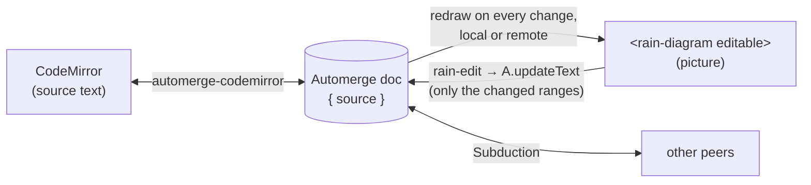

# `@inkandswitch/downpour-editor`

> [!NOTE]
> A working spike, not yet an editor. Text and picture edits sync between browsers through Subduction, but there's no highlighting, no per-person undo, and no presence yet.

A collaborative editor for rain and certflow diagrams. The source text lives in an Automerge document, synced with automerge-repo v3 over [Subduction](https://github.com/inkandswitch/subduction). The text is edited in CodeMirror and the picture in an editable [`<rain-diagram>`](../rain-diagram/), side by side. The single-user [preview](../preview/) stays as it is: no build step, no dependencies.

```console
$ pnpm --filter @inkandswitch/rain-diagram build   # the component's Wasm
$ cd javascript/editor
$ node node_modules/vite/bin/vite.js               # dev server (or `pnpm dev`)
```

Open the page, then open its URL (with the `#automerge:…` it adds) in another browser. `?sync=wss://…` picks a different Subduction server.

## How it fits together



- **The document is text.** The diagram is always derived from `source`. A concurrent edit can't corrupt a structure; at worst the merged text doesn't parse, and the picture shows the error.
- **Picture edits become splices.** The component reports a whole rewritten source. `updateText` diffs it against the document and applies only the changed ranges, so someone typing elsewhere at the same moment keeps their edit.

## The stack (all pinned: these are alphas)

| Package | Version | Role |
|---|---|---|
| `@automerge/automerge-repo` | 3.0.0-alpha.2 | Documents, handles (`create`/`find` are async in v3) |
| `@automerge/automerge-repo-subduction` | 3.0.0-alpha.2 | The `SubductionBackend` passed to `new Repo({ backend })` |
| `…-subduction-network-websocket` | 3.0.0-alpha.2 | Connection to the sync server (default `wss://subduction.sync.inkandswitch.com`) |
| `…-subduction-storage-indexeddb` | 3.0.0-alpha.2 | Local storage, so documents work offline |
| `@automerge/subduction` | 0.27.0 | `createWebCryptoSigner()`: a stable peer identity per browser |
| `@automerge/automerge` | 3.5.0 | Importing it initializes the Wasm the `slim` imports share |
| `@automerge/automerge-codemirror` | 0.2.0 | CodeMirror ↔ document (written for repo 2.0; the v3 handle fits) |

## Spike results (2026-11-13)

Tested with two headless Chromium profiles against the public Subduction server:

- A new document reaches the server and loads in a fresh browser from just its URL.
- Live edits arrive in about 220 ms either way, for both typed text and picture edits.
- Concurrent edits (one typing at the top while the other edits a line through the picture) both survive, and both sides converge on the same text, in the document and in CodeMirror.

## Known problems

- **One browser, two tabs.** The IndexedDB adapter allows one live backend per database, across tabs too; this spike opens the same database in every tab. Needs a database per tab, or one tab owning storage (Web Locks) with the others in memory.
- **Size.** Automerge's Wasm is 3.6 MB (1.2 MB gzipped) and Subduction's 1.9 MB (0.7 MB gzipped), plus 0.6 MB of JS, before our own. Worth a look before this is deployed anywhere.
- **Undo.** CodeMirror's own history is local to its editor, and picture edits don't take part. Neither Automerge nor the repo has per-person undo, so it'll be built on [`../preview/history.js`](../preview/history.js) splices and Automerge cursors.

## Next

1. A database per tab (or Web Locks), so two tabs in one browser work.
2. The preview's syntax highlighting as a CodeMirror language, and its error and diagnostics display.
3. Per-person undo across text and picture edits.
4. Presence: who's here, their cursors, and what they're hovering (automerge-repo v3 has `Presence`).
5. `mountEditor(element, handle)`, so [Patchwork](../patchwork/) can host the same editor with its own document handle.
6. Deploy next to the preview on GitHub Pages, at `/downpour/editor/`.
